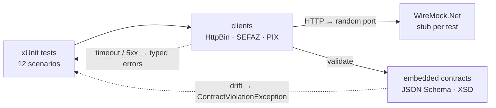

# contract-tests-wiremock

[](https://github.com/TiagoR85/contract-tests-wiremock/actions/workflows/ci.yml)
[](https://github.com/TiagoR85/contract-tests-wiremock/releases)
[](LICENSE)

Contract testing showcase: three HTTP clients (REST/JSON, SOAP/XML, REST/JSON with idempotency) verified against **local WireMock.Net stubs** across four scenarios each — success, timeout, HTTP 500, and **schema drift**. Contracts are code (JSON Schema 2020-12 + XSD) embedded in the project; a response that breaks the contract fails the test with the exact errors. Everything runs offline in seconds.



## The 12 scenarios

| API | Success | Timeout | HTTP 500 | Schema drift |
|---|---|---|---|---|
| `GET /get` (HTTPBin) | parses `origin`/`url` against the schema | delay > client timeout → `UpstreamTimeoutException` | stub 500 → `UpstreamServerException` | response without `url` → `ContractViolationException` |
| `POST /nfe/autorizacao` (SEFAZ, SOAP) | envelope validated by XSD; returns `nProt` | idem | idem | envelope without `<nProt>` → `ContractViolationException` |
| `POST /v2/cob` (PIX) | validates `Idempotency-Key` request header via the WireMock log | idem | idem | response without `chave` → `ContractViolationException` |

## Running the tests

Requires the .NET 10 SDK. No Docker, no network:

```bash
git clone https://github.com/TiagoR85/contract-tests-wiremock.git
cd contract-tests-wiremock
dotnet test ContractTests.WireMock -p:CollectCoverage=false   # fast loop (~seconds)
dotnet test ContractTests.WireMock                             # CI gate (coverage >= 80% line)
```

## How it works

- **One shared stub server** per test run (xUnit collection fixture), `Reset()` before each test — see [ADR-0001](docs/adr/ADR-0001-shared-wiremock-fixture.md).
- **Contract as code**: `ContractTests.WireMock/Contracts/*.json|*.xsd` are embedded resources; `ContractValidator` evaluates responses inside the client, so drift throws before any parsing happens — see [ADR-0002](docs/adr/ADR-0002-contract-as-code.md).
- **Typed failures**: `UpstreamTimeoutException`, `UpstreamServerException`, `ContractViolationException` — one shared `ContractHttp.SendAsync` classifies transport outcomes; see [ADR-0003](docs/adr/ADR-0003-raw-httpclient-typed-errors.md).
- **Coverage gate**: Coverlet excludes `Tests`/`Fixtures` namespaces — the 80% line gate measures the clients only.

## Decisions

- [ADR-0001](docs/adr/ADR-0001-shared-wiremock-fixture.md) — one shared WireMock server per xUnit collection
- [ADR-0002](docs/adr/ADR-0002-contract-as-code.md) — embedded JSON Schema/XSD instead of snapshots or Pact
- [ADR-0003](docs/adr/ADR-0003-raw-httpclient-typed-errors.md) — raw HttpClient with typed errors (no WCF/Refit)

## Scope

Implemented: WireMock stubbing (paths, methods, delays) · contract validation (JSON Schema + XSD) · typed error classification · idempotency-header assertion via request log · coverage-gated CI.

Backlog: 4xx/429/408 classification + retry (see `jobforge-runner`) · Pact consumer/provider flow · WireMock scenarios (stateful) · record & replay proxy · schema generation from the provider's OpenAPI · mTLS/API-key auth · WSDL-driven contract generation.

## About this repository

This repository is part of a personal study project (the "github-portfolio-dotnet" portfolio). It was built with heavy use of AI-assisted development tools, but it is held to production standards on purpose: automated tests with a coverage gate, CI on every push, contract-as-code validation, and honest documentation of trade-offs. It is not affiliated with any employer or client.

## License

MIT — see [LICENSE](LICENSE).
